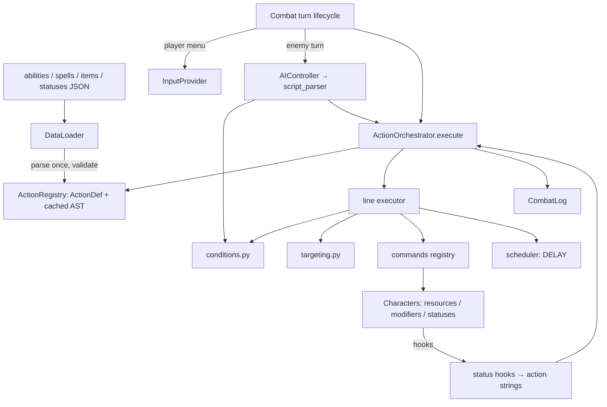

# Mechanics Implementation Plan (Goal 3)

## Goal

Replace the stubbed `ActionOrchestrator` and `AIController` with real engines and build the mechanics that
depend on them: resources, status effects, cooldowns, the six player combat actions, items and loot,
level-up perks, and branching occurrences.

The bar for "done": new abilities, spells, items, statuses, enemy behaviours and occurrences can be added
**by editing JSON only**. Adding a new *kind* of effect (a new verb, filter, status hook or occurrence
effect) means registering one handler, without touching the parser, combat loop or AI.

This plan builds on the layout produced by `restructure_plan.md` and the specs in `docs/action_system.md`,
`docs/ai_scripts.md` and `docs/game_design.md`. Where those specs are ambiguous, the gap is resolved in
[§2 Semantics](#2-semantics-resolving-spec-gaps), and the specs get updated in Milestone 6 so code and docs
agree.

### Revision notes (vs. the previous draft)

The previous draft was rewritten because it:
- **Contradicted the data.** Enemy loot tables reference items `301` and `302`, but the draft defined items
  `501–503`. It listed "Antidote", "Stamina Draught" and "Bomb" in one place and "Stamina Tonic" and
  "Fire Bomb" in another. It assigned Rogue abilities (`Quick Jab`, `Smoke Screen`) that don't exist.
- **Misused its own DSL.** `BUFF SELF STAMINA 25 0_TURNS` doesn't restore stamina: `BUFF` is a temporary
  stat modifier. The draft also ignored Predefined Actions (design doc §7.2), which the design calls for
  explicitly for the six player actions.
- **Left core semantics undefined.** It never said what a "turn" is when durations tick, how
  `ROUNDS`/`TIME_UNITS` map onto the `12500 // speed` clock, what `cooldowns: {"self": 1, "heavy_slam": 1}`
  means, how an AI resolves `CHOICE`, where a targeting phrase ends and parameters begin, how
  `20-30` (range) is told apart from `20-30` (subtraction), or why `ACTION_HAS_TAG spell` would ever match
  when no spell is tagged `spell`.
- **Had no sequencing, determinism or validation strategy.** It had no milestones or dependencies, no seeded
  RNG or scripted input for tests (every prompt currently auto-picks option 1), and no load-time
  validation of data.

---

## 1. Current state

| Area | State today | File |
|:---|:---|:---|
| Action execution | Substring check: if `"HEAL"` appears anywhere, heal `int+10`, otherwise deal `1.2 × str/int`. Targets are passed in by the caller. | `src/systems/action_orchestrator.py` |
| Enemy AI | `random.choice(enemy.abilities)`. Ignores cooldowns and `attack_scripts`. | `src/systems/ai_controller.py` |
| Player turn | Always "Standard Strike" on the lowest-HP enemy. No menu. | `src/systems/combat.py` |
| Character | HP only. `get_stat()` has a TODO for modifiers. `status_effects` is never read. No stamina, mana, cooldowns or variables. | `src/models/character.py` |
| Formula | Safe arithmetic with case-insensitive variables. **No dice support**, so `2d10+INT` can't be evaluated. | `src/formula.py` |
| Loot | Gold only. Item entries reference IDs `301`/`302`, which aren't defined anywhere. | `combat.py`, `data/enemies.json` |
| Occurrences | Always picks choice 1. Ignores nested `choices` and `stat2`/`value2`. | `src/systems/events.py` |
| Perks | Data only (2 perks, while `level_up_perk_choices` is 3). | `data/level_up_perks.json` |
| Player kit | `starting_classes.json` assigns no abilities, spells or items. `stats` contains a stray `"health"` key. | `data/starting_classes.json` |
| Input / RNG | All choices hard-coded to option 1. Module-level `random`, so nothing is reproducible. | everywhere |

---

## 2. Semantics (resolving spec gaps)

These rules are normative for the implementation. Items marked **⚑ decision** have a recommended default
that this plan proceeds with. They're collected in [§7](#7-decisions-to-confirm) for sign-off.

### 2.1 Time, turns and rounds

- **Action cost** stays `round_time_units // speed` (current behaviour, with `round_time_units = 12500`).
- **Round length.** Add `combat.reference_speed = 125`. One round is
  `round_time_units / reference_speed = 100` time units. This matches the design doc: a character with
  speed 125 acts once per round.
- **Global clock.** `clock = actor.action_time` at the start of each turn. A round boundary is crossed
  whenever `clock` passes a multiple of the round length.
- **Tie-break.** When `action_time` is equal, the higher current speed goes first, then the player, then
  list order. This is deterministic, unlike the current `min()` order.
- **Speed changes** take effect on the actor's *next* cost calculation. Accumulated `action_time` is never
  rewritten.

### 2.2 Durations, cooldowns and the single tick rule

Everything that counts in `TURNS` follows one rule, so buffs, statuses, variables and cooldowns can't drift
apart:

> A `N_TURNS` timer belongs to its **bearer** and decrements at the **end of the bearer's turn**. It skips
> the turn in which it was applied. It expires when it reaches 0.

Consequences:
- `BUFF SELF DEFENSE 10 1_TURN` cast on my turn protects me through every enemy action until the end of my
  next turn.
- `DEBUFF 1_ENEMY STR 3 1_TURN` is still active during that enemy's next action.
- `ROUNDS` and `TIME_UNITS` timers are clock-based: they expire when `clock ≥ applied_at + duration`,
  checked at each turn start.
- Durations accept singular and plural forms and dice: `1_TURN`, `3_TURNS`, `1d3_ROUNDS`, `50_TIME_UNITS`.
- **Enemy cooldowns.** An ability entry's `cooldowns` map is applied on use:
  - `"self": N` sets that ability's cooldown to `N`.
  - Any other key `"x": M` sets ability `x` to `max(current, M)`, which models shared cooldowns. The
    Cave Troll's `shield_wall` → `{"self": 4, "heavy_slam": 1}` therefore locks out its next slam.
  - Cooldown `N` means the ability is unavailable on the owner's next `N` turns. `0` means usable every
    turn.
- **Combat-scoped cleanup ⚑ decision.** At combat end, clear all statuses, temporary modifiers,
  cooldowns and pending delayed lines. Variables set *without* a duration persist on the character, so
  events can read cross-combat flags.

### 2.3 Stats, resources and aliases

- **Canonical stat keys** are lowercase, as in the data: `str dex con int wis cha defense max_health speed
  luck`, plus any hidden stat such as `fire_resistance`. The DSL is case-insensitive and goes through an
  alias table: `STR→str`, `HP→health` (current HP), `MAX_HP→max_health`, `hp_percentage→health% of
  max_health`, `STAMINA`, `MANA`.
- **Effective stat** = `base + Σ active flat modifiers (BUFF/DEBUFF)`. Percentage modifiers are out of
  scope; adding them later means one extra pass in `get_stat()`.
- **Permanent changes** (perks, occurrences) mutate `base`. When `max_health` rises, `health` rises by the
  same amount. When it falls, `health` is clamped. **⚑ decision.**
- **Resources** live in `Character.resources: dict[str, Resource(current, max)]`.
  - The player's maxima are derived from formulas in `settings.json` (values are tunable):
    ```json
    "derived_stats": {
      "max_stamina": "40 + 5 * (con - 10)",
      "max_mana":    "20 + 5 * (int - 10)"
    }
    ```
    That gives the Warrior 60 stamina and 10 mana, and the Rogue 50 stamina and 20 mana.
  - Recalculate the maxima whenever a base stat changes.
  - `combat.stamina_regen_per_turn` (default 5) prevents stamina soft-locks. Mana doesn't regenerate in
    combat.
  - Resources persist between combats. Rest events refill them. **⚑ decision.**
  - Enemies have no resources and **ignore `costs`**, per the design doc. Their abilities are gated only
    by cooldowns. The stray `"mana": 50` on `goblin_shaman` is removed.

### 2.4 Damage and healing pipeline

`DAMAGE target amount TYPE` resolves in this order:
1. Evaluate `amount` using the caster's **effective** stats. Dice are rolled once per target. Floor the
   result to an int.
2. If `<type>_resistance` exists on the target, multiply by `(1 − res/100)`. Resistance is clamped to
   `[−100, 90]`.
3. **Defense applies to `PHYSICAL` only. ⚑ decision.** Elemental, `POISON`, `HOLY` and `DARK` damage use
   resistances instead. This makes Defend and Shield Wall meaningful against weapons while giving spells a
   distinct identity.
4. **Minimum 1** for any hit that resolves. **⚑ decision.** This prevents unwinnable stalemates that
   currently end at the 500-turn safeguard.
5. Emit `on_damage_taken`. Record the total in `ctx.previous_damage_dealt`.

`HEAL` ignores defense, caps at `max_health`, and never targets dead characters (there's no revive in
scope).

### 2.5 Amount and parameter grammar

- Every parameter is **one whitespace-free token**. `1.5*STR` and `2d10+INT` are valid; `1.5 * STR` isn't.
- An amount token is resolved in this order:
  1. An integer.
  2. A **range**, matching exactly `^\d+-\d+$` (e.g. `20-30`), rolled uniformly. To subtract
     literals, write a formula such as `(30-20)`.
  3. A **formula**. `formula.py` is extended with dice atoms (`NdM`, rolled at evaluation), stat variables
     through the alias table, and the context variable `PREVIOUS_DAMAGE_DEALT`.

### 2.6 Targeting

Resolution order for a target phrase: **group pool → filters → quantity selection**.

- **Groups are relative to the caster.** `ENEMY` means the opposing side. `ALLY` means the caster's side
  and **includes the caster**. **⚑ decision.** This lets the Goblin Shaman's `HEAL 1_ALLY` heal itself.
  Dead characters are never in a pool.
- **Quantifier.** `N`, `ALL`, or dice (`1d3`). Selection never picks duplicates. If the pool has fewer than
  N members, take the whole pool. An empty pool means the line does nothing.
- **Mode.**
  - `CHOICE`: the player is prompted through the input provider. An AI caster uses its targeting policy
    (§2.8).
  - `RANDOM`: seeded RNG.
  - **No mode given: `RANDOM`. ⚑ decision.**
  - When the pool size is at most N, no prompt is shown.
- **Back-references.** `PREVIOUS_TARGETS`, `ALL_TARGETS_LINE<L>`, `SPECIFIC_TARGET target<L>.<I>` and
  `ALL_TARGETS_SO_FAR` read targets recorded on the `ExecutionContext`. Line and index numbers are
  1-based. A reference to an unexecuted line resolves to an empty pool and logs a warning.
- **Positional selectors** (`LEFT_OF`, `RIGHT_OF`, `ADJACENT_TO`) are **deferred**, because there's no
  battlefield position model yet. The parser recognises them and reports `unsupported`, so data that uses
  them fails validation loudly instead of misbehaving.

### 2.7 Conditions (shared by `IF` lines and AI scripts)

A condition is one or more **clauses** joined by `AND`, `OR` or `NOT`, with parentheses allowed.
Precedence is `NOT > AND > OR`. There are three kinds of clause:

| Clause kind | Form | True when |
|:---|:---|:---|
| Character clause | `<selector> [filters]`, e.g. `SELF WITH_STAT HP < 50%`, `LAST_ACTOR IS_PLAYER`, `ALL_ALLIES WITH_STAT HP < 50%` | it resolves to ≥ 1 character |
| Action clause | `LAST_ACTION ACTION_HAS_TAG <tag>` | the last logged action has the tag |
| Ability clause | `ABILITY <id> IS_READY` | the caster owns `<id>` and its cooldown is 0 |

**Parsing rule for `AND`/`OR`.** If the token after `AND` or `OR` is a subject keyword (`SELF`, `PLAYER`,
`LAST_ACTOR`, `LAST_ACTION`, `ABILITY`, or a base selector), it starts a new clause. Otherwise it joins
filters inside the current clause. This is how `IF LAST_ACTOR IS_PLAYER AND LAST_ACTION ACTION_HAS_TAG
spell` parses.

Filters:
- `WITH_TAG`, `WITH_STAT <stat> <op> <value>[%]`, `HAS_STATUS`, `EXISTS_VARIABLE`, `IS_PLAYER`,
  `ALLY_COUNT <op> N` and `ENEMY_COUNT <op> N`. The two count filters exclude the subject itself.
- Operators: `> < >= <= = == !=`. `=` and `==` are equivalent.
- `WITH_STAT` falls back to the character's variables when the name isn't a stat, per the spec. A missing
  variable compares as `null`, so only `!=` can be true against it.

**Implicit action tags.** Every action definition automatically gets a source tag: `technique`
(abilities.json), `spell` (spells.json), `item` (items.json) or `basic` (predefined). Without this,
`ACTION_HAS_TAG spell` from the AI spec could never match the current data.

### 2.8 AI-specific resolution

- **`CHOICE` for an AI caster**, policy chosen by verb:
  - `HEAL`: the lowest health-% target.
  - `DAMAGE`, `DEBUFF`, `APPLY`: the lowest current-HP target.
  - `BUFF`, `SET`, `RESTORE`, `CLEANSE`: the caster first if eligible, otherwise random.
  - An action may override this with an optional `"ai_target": "lowest_hp" | "highest_hp" | "random" |
    "self_first"` field.
- **`use_ability <id>`** must name an ability in the enemy's own `abilities` list. Data validation
  enforces this.
- **A line whose action is on cooldown is treated like a blank line.** It's skipped without consuming a
  script turn.
  - If a full pass over the script finds nothing usable, fall back to a random ready ability.
  - If no ability is ready, the enemy **waits**: the turn is spent and nothing happens.
  - This removes the infinite-skip loop the spec otherwise allows.
- Script selection, `interruptible`, restart-at-line-0 on switch, fallback to the first script, and the
  no-scripts random fallback follow `ai_scripts.md` exactly.

### 2.9 Delayed lines (`DELAY`)

- `DELAY <mode> TURNS N` fires at the **start of the caster's N-th subsequent turn**, before status ticks
  and before the caster acts. The caster still takes that turn. `ROUNDS` and `TIME_UNITS` fire when the
  clock reaches the due time.
- The `IF` clause and the targets on a delayed line are evaluated **when it fires**, not when it's queued.
  This is the only reading under which both spec examples (Ritual of Sacrifice and Defensive Charge) work.
- `BLOCKING` suspends the remaining lines. They resume right after the delayed line fires, within the same
  hook. `NONBLOCKING` queues the line and continues immediately.
- **If the caster dies, its pending delayed lines are cancelled. ⚑ decision.**
- Delayed lines don't survive combat end (§2.2).

---

## 3. Architecture

### 3.1 Module layout

```
src/
├── rng.py                         # [NEW] single seeded random.Random, injected everywhere
├── io/
│   └── input_provider.py          # [NEW] InputProvider protocol + Console / Scripted / Auto
├── formula.py                     # [MODIFY] dice atoms, alias-aware variable lookup
├── models/
│   ├── character.py               # [MODIFY] resources, modifiers, statuses, cooldowns, variables, timers
│   ├── player.py                  # [MODIFY] inventory dict, known actions, derived-stat recalculation
│   ├── enemy.py                   # [MODIFY] typed AIState, cooldown map seeding
│   ├── status.py                  # [NEW] StatusDef (data) + ActiveStatus (runtime)
│   └── item.py                    # [NEW] ItemDef
├── systems/
│   ├── actions/                   # [NEW] Action DSL engine
│   │   ├── definitions.py         #   ActionDef + ActionRegistry (abilities, spells, items, predefined)
│   │   ├── lexer.py
│   │   ├── nodes.py               #   AST dataclasses (named to avoid confusion with stdlib `ast`)
│   │   ├── parser.py              #   line + condition parser; returns AST plus diagnostics
│   │   ├── conditions.py          #   clause/filter evaluation (also used by AI)
│   │   ├── targeting.py           #   pool → filter → select
│   │   ├── commands.py            #   @register_command verbs
│   │   ├── filters.py             #   @register_filter predicates
│   │   ├── predefined.py          #   @register_predefined functions (attack, defend, run)
│   │   ├── scheduler.py           #   delayed-line queue keyed by (caster, turn index | clock)
│   │   └── context.py             #   ExecutionContext / CombatContext
│   ├── ai/                        # [NEW]
│   │   ├── script_parser.py       #   use_ability / WEIGHTED_CHOICE / CHANCE / IF-ELSE IF-ELSE
│   │   └── policy.py              #   AI CHOICE targeting policies
│   ├── action_orchestrator.py     # [MODIFY] thin facade: execute(caster, action_def, ctx) -> ActionResult
│   ├── ai_controller.py           # [MODIFY] thin facade over ai/: script selection + execution state
│   ├── combat.py                  # [MODIFY] turn lifecycle, player menu, hooks, CombatResult
│   ├── combat_log.py              # [NEW] ordered log → LAST_ACTOR / LAST_ACTION
│   ├── effects.py                 # [NEW] @register_effect for permanent, non-combat effects
│   ├── perks.py                   # [NEW] draw + apply level-up perks
│   └── events.py                  # [MODIFY] nested occurrences, effect lists, Rest refills resources
└── data_loader.py                 # [MODIFY] load items/statuses, build ActionRegistry, validate()
```

`action_orchestrator.py` and `ai_controller.py` stay as the public entry points, so existing imports keep
working.

### 3.2 Extension points

Each of these is the *only* place to touch when adding a new kind of thing:

| To add… | Register in | Example |
|:---|:---|:---|
| A command verb | `actions/commands.py` → `@register_command("SUMMON")` | `SUMMON`, `DISPEL` |
| A target filter | `actions/filters.py` → `@register_filter("WITH_ELEMENT", arity=1)` | |
| A predefined action | `actions/predefined.py` → `@register_predefined("steal")` | |
| A status behaviour | `data/statuses.json` only (hooks are action strings) | `BURN`, `REGEN` |
| A lifecycle hook | constant in `context.py` plus one `emit()` call in `combat.py` | `on_round_start` |
| An occurrence/perk effect | `systems/effects.py` → `@register_effect("learn_action")` | |
| An AI target policy | `ai/policy.py` → `@register_policy("highest_threat")` | |

Filters declare their **arity** (the number of argument tokens). That fixed arity is what lets the parser
know where a targeting phrase ends and the parameters begin.

### 3.3 Execution model



- **Parse once, at load.** Every `action_string`, `activation_condition`, script line and status hook is
  parsed when `DataLoader.load_all()` runs. `DataLoader.validate()` returns diagnostics with the file, id,
  line number and message.
  - The game logs warnings and keeps running, per the spec's "malformed lines are ignored with a warning".
  - The test suite asserts that shipped data has **zero** diagnostics.
- **Orchestrator contract.** `execute(caster, action_def, ctx) -> ActionResult`. The orchestrator resolves
  targets itself. `Combat` no longer passes `targets=[...]`.
  - Costs are checked and paid by `Combat` before calling `execute`. Enemies skip costs.
  - Cooldowns are applied after execution.
- **`ActionResult`** is a dataclass. Each line records its targets, damage, healing and statuses applied,
  plus an `skipped_reason`. `Combat` prints from this result, so the engine itself never prints.

### 3.4 Combat turn lifecycle

```
loop:
  actor = next by (action_time, -speed, is_player, list order)
  clock = actor.action_time; process clock-based expiries and ROUNDS/TIME_UNITS delays
  start_of_turn(actor):  fire due TURNS delays → on_turn_start hooks (e.g. POISON tick)
  if actor died or combat over → skip to end checks
  act:  player → menu via InputProvider | enemy → AIController
  end_of_turn(actor):    tick TURN timers (skip just-applied) → resource regen → on_turn_end hooks
  actor.action_time += round_time_units // effective speed
  check victory / defeat / fled after every action and every hook
```

`Combat.run()` returns `CombatResult.VICTORY | DEFEAT | FLED` instead of `bool`. `CombatEvent` maps the
result: `DEFEAT` ends the run; `FLED` continues to the next floor without rewards.

### 3.5 Player combat actions

| Menu | Implementation | Behaviour |
|:---|:---|:---|
| Attack | predefined `attack` | `DAMAGE 1_ENEMY CHOICE <formula> PHYSICAL`. The formula comes from the class's optional `basic_attack` field (default `1.0*STR`), so the Rogue can scale with DEX. |
| Defend | predefined `defend` | `BUFF SELF DEFENSE <combat.defend_formula> 1_TURN` (default `5+CON/2`). |
| Technique | `ActionDef` from `abilities.json` | Lists known techniques with cost and affordability. Paid in stamina. |
| Cast | `ActionDef` from `spells.json` | Same, paid in mana. |
| Bag | `ActionDef` from `items.json` | Lists combat-usable stacks. Decrement the stack on use. |
| Run | predefined `run` | Chance `clamp(50 + (player_speed − avg_enemy_speed)/2, 10, 90)%` using settings keys. **Not allowed in Boss events. ⚑ decision.** A failed attempt still costs the turn. |

- Selecting an unaffordable or unusable option re-prompts and doesn't cost a turn.
- Every option has a "back" entry.
- The predefined actions are ordinary `ActionDef`s with `predefined_action: {"name": ..., "params": {...}}`
  and exactly the shape that design doc §7.2 describes, so enemies or items could use them too.

### 3.6 Input and randomness

- **`InputProvider.choose(prompt, options) -> int`** has three implementations:
  - `ConsoleInput` for normal play.
  - `ScriptedInput([...])` for tests; it raises if it runs out of answers.
  - `AutoInput` for unattended demo runs; it picks the first valid option.
- Every current "pick option 1" site uses the provider: class select, path select, occurrences, combat
  menu, targeting `CHOICE` and perks.
- **`src/rng.py`** exposes one `random.Random`. `utils.roll_dice` and `weighted_choice` take an optional
  `rng`.
- **`main.py`** gains `--seed N` and `--auto`. The automated end-to-end run in the verification plan is
  `python3 main.py --auto --seed 1`.

---

## 4. Data changes

All cross-references use **slugs**, consistent with `ability_id: "heavy_slam"`. Numeric `id` fields stay as
metadata only. Old shapes are migrated in place; there's no legacy shim.

| File | Change |
|:---|:---|
| `settings.json` | Add `combat.reference_speed`, `combat.stamina_regen_per_turn`, `combat.defend_formula`, `combat.run` (base, speed factor, min, max, disallowed subtypes) and `player.derived_stats`. |
| `data/items.json` **[NEW]** | `health_potion` (`HEAL SELF 35`), `stamina_tonic` (`RESTORE SELF STAMINA 25`), `antidote` (`CLEANSE SELF POISON`), `fire_bomb` (`DAMAGE ALL_ENEMIES 25 FIRE`). Fields: `name`, `description`, `tags`, `usable_in_combat`, `action_string`. |
| `data/statuses.json` **[NEW]** | `POISON`: `{"stacking": "refresh", "tags": ["debuff"], "hooks": {"on_turn_start": "DAMAGE SELF 4 POISON"}}`. `stacking` is one of `refresh`, `stack` or `ignore`. **Undefined status names stay legal** as plain markers, so `APPLY SELF ritual_mark 3_TURNS` from the spec keeps working; validation reports them as info, not errors. |
| `data/abilities.json` | Add `quick_jab` (`DAMAGE 1_ENEMY CHOICE 0.8*DEX PHYSICAL`, 5 stamina) and `smoke_screen` (`DEBUFF ALL_ENEMIES SPEED 30 2_TURNS`, 15 stamina). Smoke Screen exercises speed debuffs feeding into turn order. |
| `data/starting_classes.json` | Remove `stats.health`. Add `abilities`, `spells`, `starting_items` and `basic_attack`. Warrior: `heavy_slam`, `shield_wall`, no spells, 2× `health_potion`. Rogue: `quick_jab`, `smoke_screen`, spell `poison_sting`, 2× `health_potion` and 1× `antidote`, `basic_attack: "1.0*DEX"`. |
| `data/enemies.json` | Loot changes `item_id: 301` → `"health_potion"` and `302` → `"fire_bomb"`. Remove `goblin_shaman.stats.mana`. Add `attack_scripts` (below). |
| `data/events.json` | Occurrence choices change from `type`/`stat2`/`value2` to `"effects": [...]`, e.g. `[{"type": "stat_change", "stat": "str", "value": 2}, {"type": "stat_change", "stat": "max_health", "value": -10}]`. Nested `choices` are unchanged. |
| `data/level_up_perks.json` | Add `"repeatable"` (default `true`) and at least 2 more tier1 perks so a draw of 3 is meaningful. Rename effect type `stat_increase` → `stat_change` so perks share the effect registry. |

Enemy scripts. Each one exercises a different engine path:

```jsonc
// goblin: intentionally NO scripts → exercises the random-ready-ability fallback
"goblin_shaman": { "attack_scripts": [{
  "activation_condition": "IF SELF",
  "interruptible": true,
  "script_lines": [
    "IF ABILITY minor_heal IS_READY AND ALL_ALLIES WITH_STAT HP < 50% { use_ability minor_heal } ELSE { use_ability heavy_slam }"
  ]
}]},
"cave_troll": { "attack_scripts": [
  { "activation_condition": "IF SELF WITH_STAT hp_percentage > 50", "interruptible": true,
    "script_lines": ["use_ability heavy_slam"] },
  { "activation_condition": "IF SELF WITH_STAT hp_percentage <= 50", "interruptible": false,
    "script_lines": [
      "IF ABILITY shield_wall IS_READY { use_ability shield_wall } ELSE { use_ability heavy_slam }",
      "WEIGHTED_CHOICE { WEIGHT 70: use_ability heavy_slam } { WEIGHT 30: use_ability shield_wall }"
    ] }
]},
"orc_grunt": { "attack_scripts": [{
  "activation_condition": "IF SELF", "interruptible": true,
  "script_lines": ["use_ability heavy_slam", "CHANCE 50 { use_ability heavy_slam }"]
}]}
```

New verbs `RESTORE <target> <resource> <amount>` and `CLEANSE <target> <status|ALL_DEBUFFS>` are spec
extensions. They're added to `action_system.md` in Milestone 6. They also prove the command registry works,
because each is one handler.

---

## 5. Milestones

Each milestone ends with a green test suite and a runnable `python3 main.py --auto --seed 1`.

```
M0 Foundations ──► M1 Action DSL ──► M2 Combat integration ──┬─► M3 Enemy AI
        │                                                    └─► M4 Items & loot ──┐
        └──────────────────────────────────────────────────────► M5 Progression ◄──┘
                                                                      │
                                                              M6 Docs & cleanup
```

### M0: Foundations
- `rng.py`, `InputProvider` and its three implementations. Thread them through `main.py`, `EventManager`,
  `events.py` and `Combat`. Add `--seed` and `--auto`.
- Formula: dice atoms, an alias-aware variable resolver, and `PREVIOUS_DAMAGE_DEALT`.
- `Character`:
  - `resources`, `modifiers`, `statuses`, `cooldowns`, `variables`.
  - `get_stat()` with modifier layering, plus `tick_turn_timers()` implementing the single tick rule.
  - Damage-pipeline helpers (`apply_damage(amount, type)`).
- `Player`: derived-stat recalculation, `inventory: dict[str, int]`, `known_abilities` and `known_spells`.
- **Done when** the existing 18 tests pass unchanged, and the new tests for the formula, modifiers, tick
  rule and damage pipeline pass.

### M1: Action DSL engine
- Lexer, parser (lines and conditions), nodes, diagnostics.
- Targeting, conditions, filters, and the commands `DAMAGE HEAL BUFF DEBUFF APPLY SET RESTORE CLEANSE`.
- `ActionDef` and `ActionRegistry`. `DataLoader` parses all actions at load. `validate()`.
- Scheduler is implemented and unit-tested here against a fake clock. It's wired into combat in M2.
- `ActionOrchestrator.execute()` switches to the new contract. Combat is temporarily adapted, so the
  player still auto-attacks.
- **Done when** every shipped `action_string` parses with zero diagnostics, and both spec examples (Ritual
  of Sacrifice and Defensive Charge) run correctly in tests.

### M2: Combat integration
- The turn lifecycle (§3.4), round and clock tracking, the tie-break rule, and `CombatResult`.
- `statuses.json`, the status hook bus (`on_apply`, `on_turn_start`, `on_turn_end`, `on_damage_taken`,
  `on_expire`) and the combat log.
- Player menu: Attack, Defend, Technique, Cast and Run (Bag lands in M4), with cost checks.
- Predefined action registry.
- Combat-end cleanup (§2.2).
- **Done when** a scripted-input fight shows Defend reducing physical damage, Poison ticking and expiring,
  Smoke Screen changing turn order, Run outcomes, and the Boss run block.

### M3: Enemy AI
- `script_parser.py`: `use_ability`, `WEIGHTED_CHOICE`, `CHANCE`, and `IF / ELSE IF / ELSE` with nesting.
- `AIController`: script selection, the interruptible lock, line pointer, blank and cooldown skipping,
  fallbacks and wait.
- Enemy cooldown map, including shared cooldowns. AI `CHOICE` policies.
- Enemy script data (§4). Validation that `use_ability` targets are owned.
- **Done when** the Shaman heals its lowest-HP% ally only when below 50% and `minor_heal` is ready, the
  Troll locks into phase 2 below 50% HP, the Goblin uses only ready abilities, and an enemy whose
  abilities are all on cooldown waits.

### M4: Items and loot
- `items.json`, `ItemDef`, starting items, and the Bag menu.
- Loot drops in `_process_post_combat_rewards()` for both gold and items, with `min_amount`/`max_amount`.
  Unknown item slugs warn at validation.
- **Done when** potions, tonics, antidotes and bombs work through the DSL in combat, stacks decrement and
  disappear at 0, and seeded loot drops land in the inventory.

### M5: Progression and occurrences
- `effects.py` registry: `stat_change`, `heal`, `restore`, `gold`, `item` and `none`, shared by perks and
  occurrences.
- `perks.py`:
  - **Tier selection.** Use the highest `tierN` pool whose number is ≤ `ceil(level / boss_level_interval)`.
    Floors and perks share the same tier definition.
  - **Draw.** Draw `min(level_up_perk_choices, pool)` perks without replacement, excluding owned
    non-repeatable ones.
  - **Timing.** Perks are chosen after combat rewards, once per level gained.
- Occurrences: recursive nested choices through the `InputProvider`, effect lists, migrated data.
- Rest refills stamina and mana as well as healing.
- **Done when** a multi-level-up offers one perk choice per level, `strange_idol`'s nested path applies
  both stat changes, and `max_health` changes follow §2.3.

### M6: Docs and cleanup
- Update `action_system.md` with: the grammar, the amount-resolution order, `RESTORE`/`CLEANSE`, the
  default mode, `ALLY` including self, positional selectors marked deferred, and the duration and delay
  semantics.
- Update `ai_scripts.md` with clause chaining, implicit action tags, cooldown-skip and wait, and the AI
  `CHOICE` policy.
- Remove the resolved TODOs from `game_design.md`. Add an "Adding content" section to the README.
- Remove the unused `tier_tag` in `event_manager.py` or route it through the shared tier helper.

---

## 6. Verification

Tests stay on stdlib `unittest`, matching the existing suite; `pytest` still discovers them. Every
randomised test injects a seeded `Random` or a stub. No test reads from stdin.

| Test file | Covers |
|:---|:---|
| `test_formula.py` (extend) | Dice atoms (seeded), stat aliases, `PREVIOUS_DAMAGE_DEALT`, range vs. subtraction |
| `test_character.py` | Modifier layering, tick rule (applied-turn skip), resources and derived stats, `max_health` up/down, damage pipeline (defense physical-only, resistances, min 1) |
| `test_action_parser.py` | Every grammar form, where filters end and parameters begin, `DELAY` before `IF`, malformed line → diagnostic, positional → `unsupported` |
| `test_targeting.py` | Groups relative to the caster, `ALLY` includes self, filters before quantity, no duplicates, pool smaller than N, `CHOICE` through `ScriptedInput`, back-references |
| `test_conditions.py` | Clause chaining with `AND`/`OR`/`NOT`/parentheses, variable fallback in `WITH_STAT`, `ABILITY … IS_READY`, `LAST_ACTION ACTION_HAS_TAG spell` via the implicit tag |
| `test_commands.py` | Each verb, including `RESTORE` and `CLEANSE`. Status stacking modes. |
| `test_delays.py` | `BLOCKING` vs `NONBLOCKING` ordering, `IF` evaluated at fire time, caster death cancels, the two spec examples end to end |
| `test_combat_turn_order.py` (extend) | Tie-break, speed debuff changes cadence, round-length math, `FLED` result |
| `test_combat_actions.py` | Each player menu action through `ScriptedInput`, unaffordable → re-prompt with no turn cost, Boss blocks Run |
| `test_ai_scripts.py` | Selection order, the interruptible lock, restart at line 0, blank/`CHANCE`-false/cooldown lines skipped without consuming a turn, all-on-cooldown → wait, shared cooldowns, AI `CHOICE` policy |
| `test_items_loot.py` | Item use and stack decrement, seeded loot drops, unknown item slug → diagnostic |
| `test_progression.py` | Perk tier and draw size, non-repeatable exclusion, multi-level-up, nested occurrence effects |
| `test_data_integrity.py` | `DataLoader.validate()` on shipped data returns **zero errors**, and every slug cross-reference resolves |

**End to end.** `python3 main.py --auto --seed 1` reaches floor 10 or dies, with no exceptions and no
validation warnings. A short golden-log test runs a fixed seed through a few floors to catch accidental
behaviour changes.

**Manual.** Play both classes interactively. Use every menu action, see the Shaman heal and the Troll
change phase, pick up and use a looted item, level up and choose a perk, and take both branches of
`strange_idol`.

---

## 7. Decisions to confirm

The plan proceeds with these defaults unless overridden:

| # | Decision | Default | Alternative |
|:---|:---|:---|:---|
| 1 | Which damage types defense reduces | `PHYSICAL` only | All types (current behaviour) |
| 2 | Minimum damage per hit | 1 | 0 (current) |
| 3 | Does `ALLY` include the caster? | Yes | No, and add an `OTHER_ALLY` group |
| 4 | Selection mode when omitted | `RANDOM` | `CHOICE` |
| 5 | Run | Allowed except in Boss events; fleeing gives no rewards but clears the floor | Also disallowed in Ordeals |
| 6 | Caster dies with pending `DELAY` lines | Cancelled | Still fire |
| 7 | Stamina and mana between combats | Persist; Rest refills them | Refill at every combat start |
| 8 | Raising `max_health` permanently | Also heals by the same amount | Raises the cap only |
| 9 | Variables set without a duration | Persist across combats | Cleared at combat end |

## 8. Out of scope

Shop, save/load, difficulty scaling, positional targeting, percentage stat modifiers, out-of-combat item
use, equipment and weapons, summoning, and per-action time costs. The registries above are designed so
each of these can be added later without reworking the engine.

---

## 9. Implementation notes (2026-10-10)

All milestones M0–M6 are implemented with the §7 defaults. Verification:
- 129 unit tests pass (`python3 -m unittest discover -s tests`).
- `DataLoader.validate()` reports no diagnostics on the shipped data.
- `python3 main.py --auto --seed N` completes cleanly for 15 seeds.

Where the implementation deviates from the plan:
- **No `src/models/item.py`.** Items are `ActionDef`s with `source="item"` and `usable_in_combat`, so they
  share the definition, parsing and validation used by techniques and spells. A separate model would only
  duplicate those.
- **New modules not listed in §3.1:**
  - `src/systems/battle.py` holds per-combat state: sides, clock, scheduler, log and hook dispatch. Engine
    tests can build a battle without running the `Combat` loop or its UI.
  - `src/stats.py` holds the stat alias table.
  - `src/systems/actions/registry.py` and `executor.py` were split out of `commands.py` and the
    orchestrator.
- **Data change beyond §4.** The Goblin Shaman's `heavy_slam` cooldown is now `0` (was `1`). With a
  1-turn cooldown, its `ELSE` branch was unusable every other turn, and the random-ready fallback (§2.8)
  made it cast `minor_heal` on healthy allies. That broke the M3 acceptance criterion.
- **Existing tests.** One assertion changed: `Combat.run()` now returns `CombatResult`, so
  `assertTrue(result)` became `assertIs(result, CombatResult.VICTORY)`.
- **Golden log.** Implemented as a reproducibility test plus a 15-seed smoke run, not a stored transcript.
  A transcript would break on every narration wording change.
- **`PREVIOUS_DAMAGE_DEALT`** is the total from the most recent `DAMAGE` line in the action, not strictly
  the line immediately before.

Observed but out of scope: `--auto` play only ever chooses Attack and usually dies by floor 2–7. Level 1–5
can already roll Elite ordeals, so difficulty tuning belongs with the deferred difficulty-scaling work.
