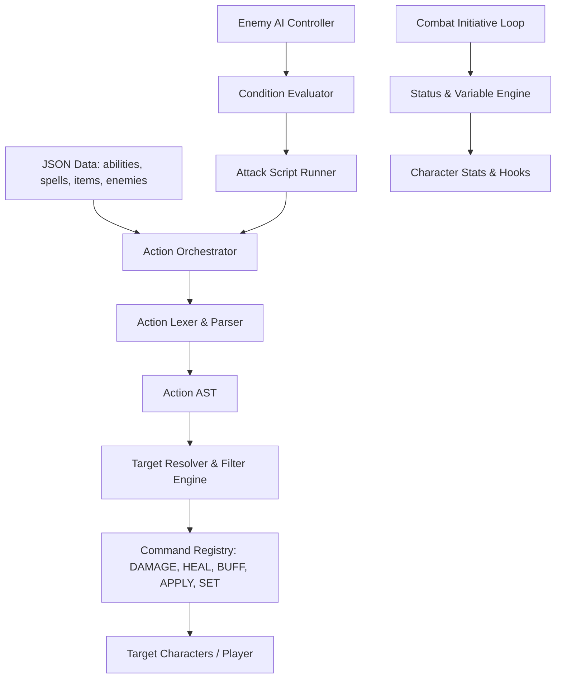

# Mechanics & Extensible Systems Implementation Plan

## Goal Description
Implement the core game mechanics for the currently stubbed and disconnected systems in **TextRogue**. The architecture must be **modular, registry-based, and highly extensible**, ensuring that newly authored abilities, spells, enemy behaviors, items, and status effects can be introduced solely via JSON data without requiring system refactoring.

---

## Architecture Principles for Extensibility

To ensure the game systems easily accommodate future content and mechanical additions, we follow four architectural pillars:

1. **Registry Pattern**: Commands (`DAMAGE`, `HEAL`, `BUFF`, `APPLY`), Target Filters (`WITH_TAG`, `WITH_STAT`), and AI Conditions are registered in central registries. Adding a new command (e.g., `SUMMON`, `CLEANSE`, `DISPEL`) is as simple as registering a handler function.
2. **Event & State Hooking**: Combat triggers standard lifecycle events (`ON_ROUND_START`, `ON_TURN_START`, `ON_DAMAGE_TAKEN`, `ON_TURN_END`, `ON_DEFEAT`). Status effects, passives, and delayed actions hook into these events cleanly.
3. **Data-Driven Execution**: Abilities, spells, items, and AI scripts share the same underlying Action DSL and condition evaluation engine. A healing potion in the inventory uses the exact same `action_string` syntax (`HEAL 1_ALLY CHOICE 50`) as a cleric's spell.
4. **Typed Context Objects**: `ExecutionContext` and `CombatContext` wrap all transient battle state (`caster`, `targets`, `previous_damage`, `last_actor`, `last_action`), preventing parameter sprawl.



---

## User Review Required

> [!IMPORTANT]
> **Starter Content Inclusion**: While this plan focuses on system architecture and mechanical engines, we will add baseline starting content to test every mechanic thoroughly:
> 1. `data/items.json`: Health Potion, Stamina Draught, Antidote, Bomb.
> 2. Starter abilities & spells assigned to `Warrior` (`Heavy Slam`, `Shield Wall`) and `Rogue` (`Quick Jab`, `Smoke Screen`).
> 3. AI `attack_scripts` added to `goblin` (retaliation & desperation logic), `goblin_shaman` (healing allies vs damage), and `cave_troll` (shield wall phase when HP < 50%).

> [!NOTE]
> **Backward Compatibility**: All existing data and configurations will continue to work without breaking changes.

---

## Proposed Changes by Subsystem

---

### Component 1: Action System DSL Engine (`src/systems/action_engine/`)

Replace the naive substring check in `ActionOrchestrator` with a full Lexer, AST Parser, Target Resolver, and Command Executor adhering to `docs/action_system.md`.

#### [NEW] `src/systems/action_engine/tokens.py`
Defines token types and keywords:
* Line Modifiers: `IF`, `DELAY`, `BLOCKING`, `NONBLOCKING`
* Time Units: `TURNS`, `ROUNDS`, `TIME_UNITS`
* Verbs: `DAMAGE`, `HEAL`, `BUFF`, `DEBUFF`, `APPLY`, `SET`
* Target Selectors: `SELF`, `1_ENEMY`, `2_ENEMIES`, `ALL_ENEMIES`, `1_ALLY`, `ALL_ALLIES`, `CHOICE`, `RANDOM`, `SPECIFIC_TARGET`, `PREVIOUS_TARGETS`, `ALL_TARGETS_SO_FAR`
* Filters: `WITH_TAG`, `WITH_STAT`, `HAS_STATUS`, `EXISTS_VARIABLE`, logical `AND`, `OR`, `NOT`

#### [NEW] `src/systems/action_engine/lexer.py`
Tokenizes multi-line action strings into structured token streams, handling comments, whitespace, and parameter expressions.

#### [NEW] `src/systems/action_engine/ast.py`
Node representations:
* `ActionNode`: Represents a complete ability/spell/item action (contains a list of `ActionLineNode`s).
* `ActionLineNode`: Modifiers (`DelayModifier`, `IfCondition`), Command verb, Target phrase, and parameter string/formula.
* `TargetPhraseNode`: Quantifier, group, selection mode (`CHOICE`, `RANDOM`), and chained filter nodes.

#### [NEW] `src/systems/action_engine/parser.py`
Recursive-descent parser producing validated ASTs from tokens.

#### [NEW] `src/systems/action_engine/resolver.py`
Evaluates targeting phrases against live combat participants:
* Filters targets by stats (`WITH_STAT HP < 50%`), status tags (`HAS_STATUS POISON`), and tags (`WITH_TAG goblin_kin`).
* Handles player prompt on `CHOICE` vs RNG on `RANDOM`.
* Resolves contextual references (`PREVIOUS_TARGETS`, `ALL_TARGETS_SO_FAR`, `SPECIFIC_TARGET target1.1`).

#### [NEW] `src/systems/action_engine/commands.py`
Extensible command handlers registered via `@register_command`:
* `DamageCommand`: Computes dice/formula (`1d6+DEX`, `1.5*STR`), mitigates defense, checks elemental weaknesses, logs result, updates `previous_damage_dealt`.
* `HealCommand`: Computes dice/formula (`20-30`, `int+10`), restores HP up to `max_health`.
* `BuffCommand` / `DebuffCommand`: Applies temporary stat modifiers with duration (`3_TURNS`).
* `ApplyCommand`: Attaches named status effects with duration (`APPLY 1_ENEMY CHOICE POISON 3_TURNS`).
* `SetCommand`: Sets arbitrary variables on characters (`SET SELF is_charging true 1_TURN`).

#### [MODIFY] `src/systems/action_orchestrator.py`
Refactor to delegate to the new `action_engine` parser and executor, managing the delayed action queue for `BLOCKING` and `NONBLOCKING` delays.

---

### Component 2: Character Resources, Status Effects & Cooldowns

Bring characters from basic HP bags into full tactical combatants with Stamina, Mana, active status effects, and cooldown tracking.

#### [MODIFY] `src/models/character.py`
* Add resource fields:
  * `stamina: int = 0`, `max_stamina: int = 0`
  * `mana: int = 0`, `max_mana: int = 0`
  * `cooldowns: dict[str, int]` (tracks ability slug -> turns remaining)
  * `variables: dict[str, Any]` (supports `SET` / `EXISTS_VARIABLE`)
* Update `get_stat(name)`:
  * Layer in active stat modifiers from `status_effects` (e.g. `+10 DEFENSE` from buffs).
* Add methods:
  * `spend_resource(resource_type, amount) -> bool`
  * `restore_resource(resource_type, amount)`
  * `has_status(status_name) -> bool`
  * `add_status(effect_data)`
  * `remove_status(status_name)`
  * `tick_turn()`: decrements ability cooldowns and status durations; executes periodic effects (poison, burn, regen).

#### [MODIFY] `src/models/player.py`
* Initialize starting stamina/mana pools from Constitution, Intelligence, Wisdom.
* Track active perk IDs and player inventory.

#### [MODIFY] `src/models/enemy.py`
* Track cooldowns per ability as specified in `enemies.json` (e.g., `cooldowns: {"self": 1}`).

---

### Component 3: Enemy AI Scripting Engine (`src/systems/ai/`)

Implement the state-machine AI system described in `docs/ai_scripts.md`.

#### [NEW] `src/systems/ai/condition_evaluator.py`
Evaluates script activation conditions and line-level conditionals:
* Evaluates `IF SELF WITH_STAT hp_percentage <= 50`.
* Evaluates AI-specific conditions:
  * `PLAYER` context
  * `LAST_ACTOR IS_PLAYER`
  * `LAST_ACTION ACTION_HAS_TAG spell`
  * `ALLY_COUNT == 0`
  * `ABILITY <name> IS_READY` (checks enemy cooldown dictionary)

#### [NEW] `src/systems/ai/script_runner.py`
Executes active attack scripts:
* Evaluates script list in order; first valid condition becomes active.
* Respects `interruptible: false` locks until full script iteration is complete.
* Parses script lines:
  * `use_ability <id>`
  * `WEIGHTED_CHOICE { WEIGHT 70: action1 } { WEIGHT 30: action2 }`
  * `CHANCE <0-100> { action }`
  * `IF <cond> { action } ELSE { action }`
* Fallback to random non-cooldown ability if no script matches or no scripts defined.

#### [MODIFY] `src/systems/ai_controller.py`
Wire `AIController` to use `script_runner.py` and query live combat state.

---

### Component 4: Items & Inventory Subsystem

Implement the item data structure, combat item usage, and post-combat loot drops.

#### [NEW] `data/items.json`
Define consumable, combat, and utility items:
```json
{
  "health_potion": {
    "id": 501,
    "name": "Health Potion",
    "description": "A vial of soothing red liquid that restores 35 HP.",
    "item_type": "consumable",
    "usable_in_combat": true,
    "costs": {},
    "action_string": "HEAL SELF 35"
  },
  "stamina_tonic": {
    "id": 502,
    "name": "Stamina Tonic",
    "description": "Restores 25 Stamina.",
    "item_type": "consumable",
    "usable_in_combat": true,
    "action_string": "BUFF SELF STAMINA 25 0_TURNS"
  },
  "fire_bomb": {
    "id": 503,
    "name": "Fire Bomb",
    "description": "Throw an incendiary flask dealing 25 Fire damage to all enemies.",
    "item_type": "consumable",
    "usable_in_combat": true,
    "action_string": "DAMAGE ALL_ENEMIES 25 FIRE"
  }
}
```

#### [NEW] `src/models/item.py`
Dataclass representing an Item definition and an `ItemStack` (`item_id`, `quantity`).

#### [MODIFY] `src/systems/combat.py`
* In `_process_post_combat_rewards()`:
  * Process item drops from enemy `loot_table` (`{"type": "item", "item_id": 501, "chance": 0.5, ...}`).
  * Add acquired items to `player.inventory`.

---

### Component 5: Interactive Combat Menu & Action System Integration

Expand player turns in `combat.py` to support the 6 canonical player combat actions from `docs/game_design.md`:

1. **Attack**: Basic physical strike scaling with weapon/strength.
2. **Defend**: Grants temporary Defense buff until next turn.
3. **Technique**: List player's Stamina abilities (`abilities.json`); check cost and execute via `ActionOrchestrator`.
4. **Cast**: List player's Mana spells (`spells.json`); check cost and execute via `ActionOrchestrator`.
5. **Item / Bag**: Open inventory; select combat item; execute its action string and decrement stack.
6. **Run**: Attempt to flee based on player Speed vs average enemy Speed.

Supports both interactive console choice and non-interactive AI/automated fallback for automated testing.

---

### Component 6: Level-Up Perks & Branching Occurrences

#### [NEW] `src/systems/perk_manager.py`
* On player level up, reads `data/level_up_perks.json`.
* Filters perks for player's tier, randomly draws `settings["player"]["level_up_perk_choices"]` (default 3).
* Applies perk stat increases (`max_health +20`, `str +2`) or capability unlocks.

#### [MODIFY] `src/systems/events.py` (Occurrence Events)
* Support nested branching choices (like `strange_idol`: Pray -> Accept dark gift vs Reject).
* Support secondary stat changes (`stat2`, `value2`).
* Support gold and item rewards from occurrences.

---

## Verification Plan

### Automated Unit Tests (`tests/`)

1. **Action DSL Engine Tests (`tests/test_action_dsl.py`)**:
   * Tokenizer & parser syntax validation.
   * `DAMAGE` with formulas (`1.5*STR`) and dice (`2d10+INT`).
   * `HEAL`, `BUFF`, `APPLY` status effects, and `SET` variables.
   * Target selectors (`1_ENEMY CHOICE`, `ALL_ENEMIES`, `SELF`, `PREVIOUS_TARGETS`).
   * Target filters (`WITH_STAT HP < 50%`, `WITH_TAG`).
   * `DELAY BLOCKING` and `DELAY NONBLOCKING` queues.
2. **AI Scripting Tests (`tests/test_ai_scripts.py`)**:
   * Condition evaluation (`HP <= 50`, `ABILITY IS_READY`, `ALLY_COUNT == 0`).
   * Script lock when `interruptible: false`.
   * Fallback to random non-cooldown ability.
3. **Status & Cooldown Tests (`tests/test_status_and_cooldowns.py`)**:
   * Cooldown decrements each turn.
   * Buff application and expiration.
   * Poison periodic damage ticking.
4. **Inventory & Item Tests (`tests/test_inventory.py`)**:
   * Item usage in combat via Action DSL.
   * Item consumption and loot drop collection.
5. **Perk System Tests (`tests/test_perks.py`)**:
   * Perk drawing and application on level-up.

### Manual Verification
* Run `python3 main.py`:
  * Select Warrior or Rogue.
  * Encounter enemies with functioning AI scripts (e.g., Goblin Shaman heals wounded allies).
  * Use abilities/spells with Stamina and Mana management.
  * Pick an item from the bag during battle.
  * Level up and select from 3 offered perks.
  * Navigate multi-step branching choices in Occurrences.
